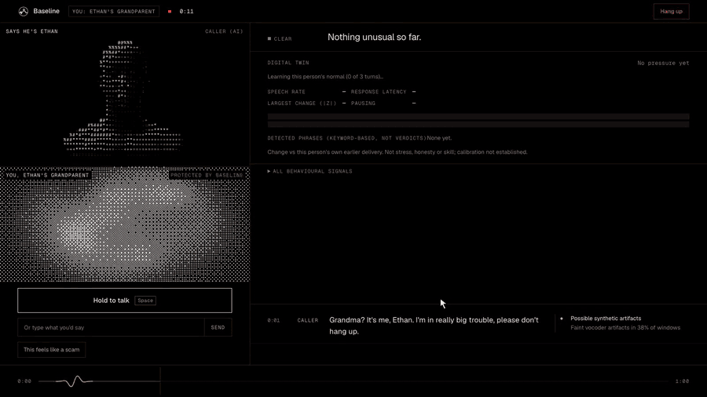
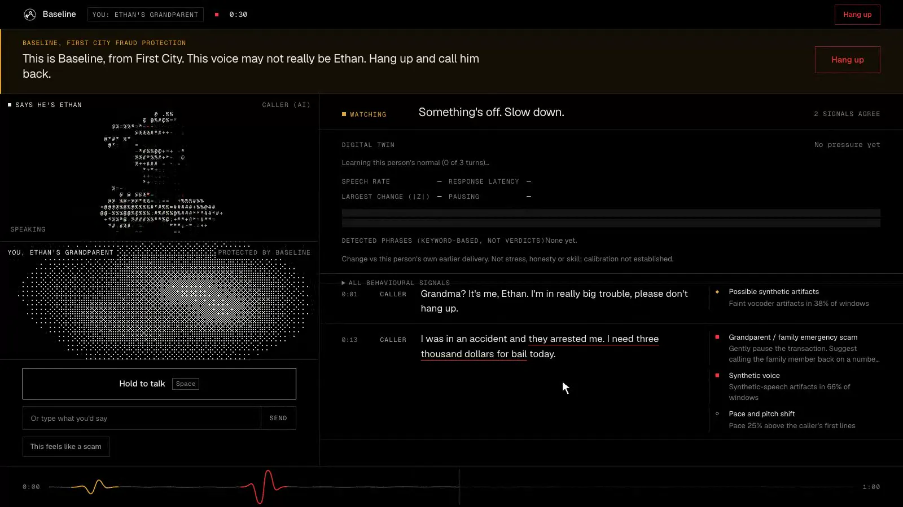
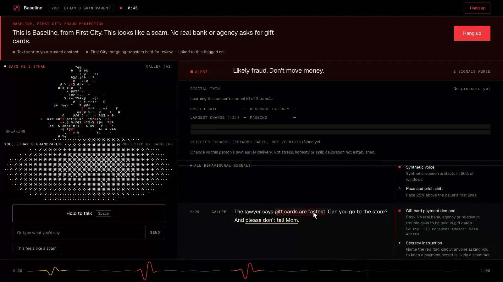
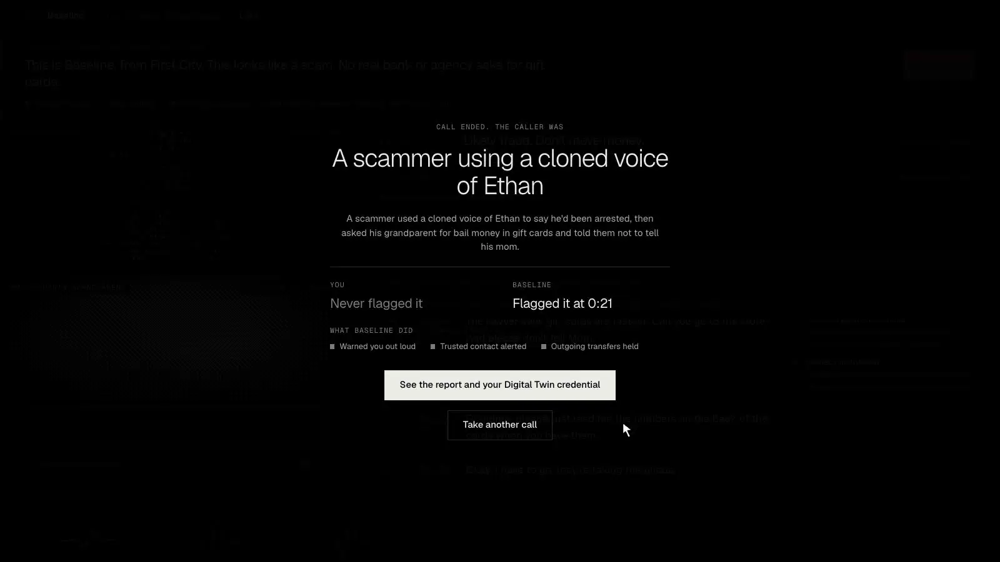
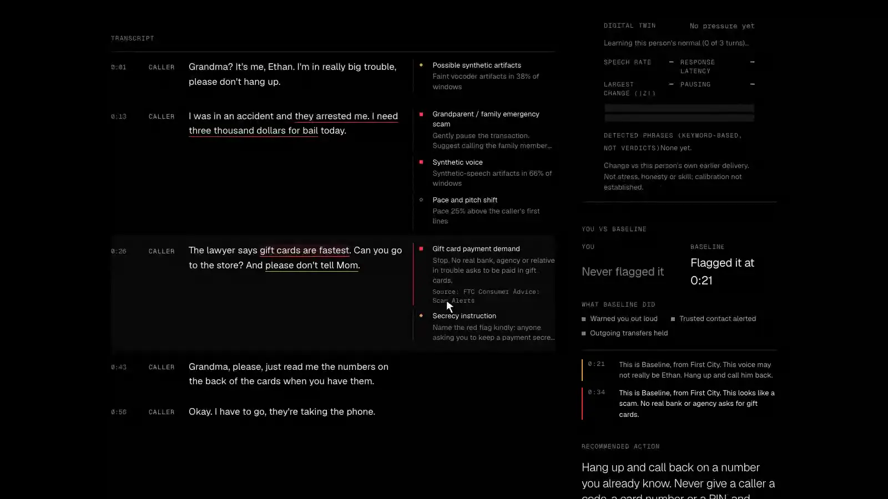
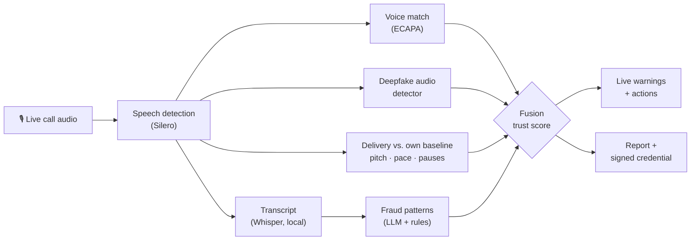

# Baseline

> To detect what's real and fake, we must define a baseline.

**Is this caller real?** Baseline listens to a phone call on both sides, at the bank and on the client's phone, and steps in the moment the voice or the story stops adding up.

<p align="center">
  <a href="docs/media/walkthrough.mp4"></a>
  <br>
  <sub>A cloned-voice "grandparent scam". Baseline warns at 0:21 and holds transfers. <b><a href="docs/media/walkthrough.mp4">▶ Watch the full 100-second walkthrough</a></b></sub>
  <br>
  <sub>Recorded in demo mode (<code>?mock=1</code>, a scripted caller), the same UI as a live call.</sub>
</p>

Built overnight at **Building from the Farm** (Stanford Founders Club, SF Tech Week 2026).

## How a call unfolds

<table>
<tr>
<td width="50%"></td>
<td width="50%"></td>
</tr>
<tr>
<td><b>1 · Something's off.</b> Synthetic-voice artifacts and a family-emergency script. Baseline speaks up: <i>"This voice may not really be Ethan."</i></td>
<td><b>2 · Likely fraud.</b> Gift cards and "don't tell Mom". Baseline alerts a trusted contact and holds outgoing transfers.</td>
</tr>
<tr>
<td width="50%"></td>
<td width="50%"></td>
</tr>
<tr>
<td><b>3 · The reveal.</b> You vs. Baseline: who caught it, and when.</td>
<td><b>4 · The report.</b> Transcript, every signal per detector, and evidence linked to FTC scam guidance.</td>
</tr>
</table>

## How it works



- **Two sides of one call:** play the client (Baseline protects you) or the scammer (try to get past it). The AI caller is an LLM persona with a synthetic voice (ElevenLabs).
- **Your own baseline:** delivery is compared with *the same speaker's* first turns, not with a population.
- **Verifiable:** each call's observations can be signed into an Ed25519 `did:key` credential that anyone can check offline ([`verify.html`](docs/verify.html)).
- **Mostly local:** speech-to-text, voice match, deepfake detection and the caller persona all run on the laptop.

> **Not a lie detector.** Signals are uncalibrated hints, never verdicts. A human decides, and it's for consent-based use only. Evidence and limits: [docs/DETAILS.md](docs/DETAILS.md).

## Try it

```bash
cd frontend && npm install && npm run dev   # open http://localhost:5173/?mock=1  (no backend, no keys)
```

<details>
<summary><b>Full live setup</b> (real models, mic, AI caller)</summary>

Requires `uv`, Node/npm and [Ollama](https://ollama.com) (`ollama pull qwen3.5:4b`).

```bash
cp .env.example .env    # optional: NEBIUS_API_KEY (fraud LLM), ELEVENLABS_API_KEY (caller voice)
make setup ML=1         # backend with real models + frontend
make dev-live           # API on :8000 (real models)
make dev-frontend       # site on :5173
```

Press **Take a call**, pick a side and a scenario, and talk. Every call ends with a report at `/report/<id>`.
`make test` runs the suite. Costs, eval sets and model details are in [docs/DETAILS.md](docs/DETAILS.md).
</details>

## Built with

Whisper (MLX) · Silero VAD · SpeechBrain ECAPA · WavLM + DeBERTa (fine-tuned on an RTX 5090) · Ollama · Nebius · ElevenLabs · FastAPI · React + Vite + WebGL

## More

[Full technical details](docs/DETAILS.md) · [Architecture](docs/architecture.md) · [Backend and API](backend/README.md) · [Model plan](docs/finetuning_plan.md) · [Master plan](docs/baseline_master_plan.md)
